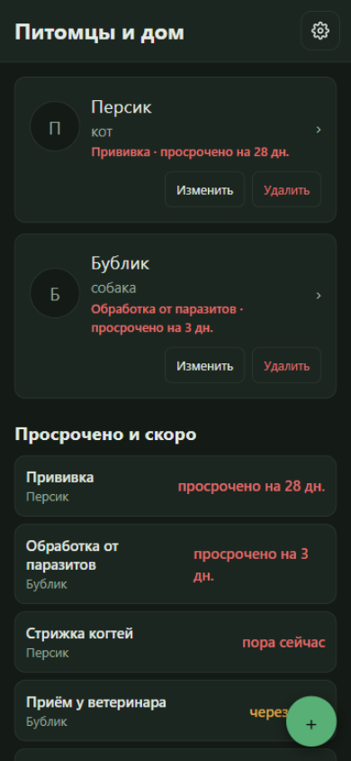
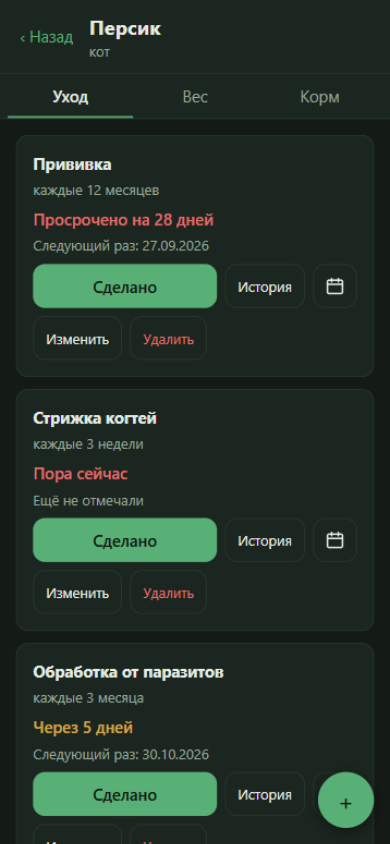
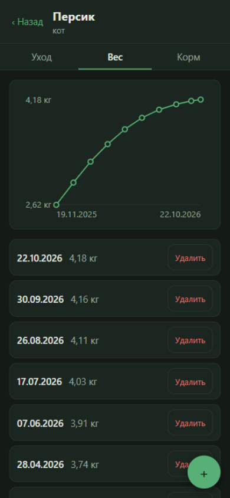
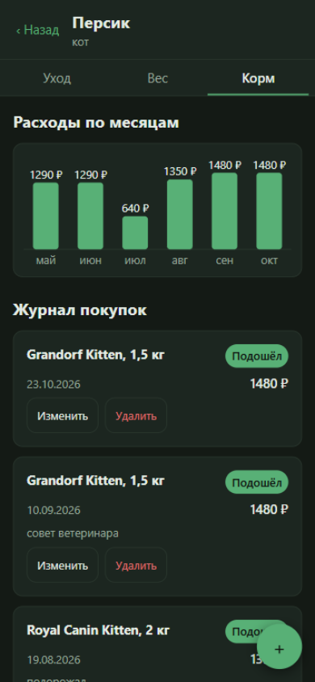

# Питомцы и дом (pet-care-tracker)

Личный трекер ухода за питомцами: прививки, обработка от паразитов, график веса,
журнал корма — и напоминания, которые живут в вашем календаре, а не в очередном
сервисе с аккаунтом. Чистый фронтенд без бэкенда: данные лежат в браузере,
любой пункт ухода выгружается в системный календарь файлом `.ics` — и календарь
сам вспоминает за сутки. Работает офлайн, подстраивается под тёмную тему
системы, свёрстан мобильным-first от 360px.

**Для кого.** Владельцы одного-трёх питомцев, которым надоело искать «когда была
последняя прививка?» по чатам с клиникой, и которые не хотят отдавать эти записи
чужому облаку. И ревьюеры портфолио: проект собран как честный кейс — каждое
решение зафиксировано в [ADR](docs/adr/), каждая фича закрыта тестами.

**Живое демо:** <https://l2cri.github.io/pet-care-tracker/> — откройте
«Настройки → Загрузить демо-набор»: два питомца с готовой историей ухода, веса
и корма. Все скриншоты ниже сняты с этого демо-набора.

## Как это выглядит

### Дашборд — что срочно



Карточки питомцев с бейджем самого срочного дела и общий список дел по всем
питомцам: просроченное — красным, ближайшие 7 дней — жёлтым. Кнопка «Сделано»
дописывает запись в историю и пересчитывает таймер от новой даты.

### Карточка питомца — уход и экспорт в календарь



У каждого пункта ухода — интервал («каждые 3 месяца»), таймер до следующего
выполнения и кнопка календаря: она скачивает `.ics` одним кликом — без сервера,
прямо из браузера. В файле — повторяющееся событие с будильником за сутки:

```ics
BEGIN:VCALENDAR
VERSION:2.0
PRODID:-//pet-care-tracker//Питомцы и дом//RU
CALSCALE:GREGORIAN
BEGIN:VEVENT
UID:00000000-0000-4000-8000-000000000001
DTSTAMP:20261025T120000Z
DTSTART;VALUE=DATE:20261030
RRULE:FREQ=MONTHLY;INTERVAL=12
SUMMARY:Прививка — Бублик
BEGIN:VALARM
TRIGGER:-P1D
ACTION:DISPLAY
DESCRIPTION:Напоминание
END:VALARM
END:VEVENT
END:VCALENDAR
```

Разовые события (визит к ветеринару) выгружаются тем же кликом — одиночным
событием на нужную дату.

### Вес — график за всю историю



Замеры хранятся целыми граммами, график строится за всю историю с автоскейлом;
тап по точке показывает дату и значение. SVG нарисован руками — без единой
чартовой библиотеки.

### Корм — журнал и расходы



Журнал покупок с вердиктом «подошёл / не подошёл» и заметкой, расходы —
столбиками по месяцам за полгода. Тот же самописный SVG.

## Инженерные решения

Каждое решение — отдельный ADR с контекстом и последствиями: [docs/adr/](docs/adr/).
Ключевые четыре:

- **Local-first без бэкенда** — [ADR-0001](docs/adr/0001-local-first-no-backend.md).
  Данные — в localStorage за интерфейсом репозитория, бэкап и перенос — JSON-файл
  с `formatVersion`. Ни аккаунтов, ни сервера, ни сетевых вызовов: личные записи
  не покидают устройство.
- **Лог выполнений — источник истины** — [ADR-0003](docs/adr/0003-completion-log-as-source-of-truth.md).
  «Следующий раз» нигде не хранится — всегда выводится из последней записи лога.
  «Сделано» — просто новая запись; смена интервала пересчитывает расписание без
  миграций и рассинхронов.
- **`.ics` вместо push** — [ADR-0004](docs/adr/0004-ics-export-instead-of-push.md).
  Push в вебе требует сервер, разрешения и пользуется неохотно; `.ics` работает
  везде. Генератор — чистый строковый модуль по RFC 5545: `RRULE` из интервала,
  `VALARM` за сутки, экранирование TEXT, свёртка длинных строк с подсчётом
  октетов UTF-8 (кириллица — два октета на символ).
- **Самописный SVG** — [ADR-0005](docs/adr/0005-hand-rolled-svg-charts.md).
  Линия веса и столбики расходов нарисованы без чартовых библиотек: весь
  JavaScript — около 90 КБ gzip вместе с React, а геометрию (автоскейл,
  вырожденные случаи «одна точка / все равны») считает и тестирует доменное ядро.

Остальные: [ADR-0002](docs/adr/0002-universal-care-subject-model.md) — модель
«подопечный» универсальна под домашних дел второй итерации (типы
`pet / item / plant` с первого дня, без будущей миграции);
[ADR-0006](docs/adr/0006-stack-and-styling.md) — CSS Modules и дизайн-токены,
тёмная тема через `prefers-color-scheme`, три экрана без роутера;
[ADR-0007](docs/adr/0007-github-pages-actions-deploy.md) — CI на GitHub Actions
и статика на GitHub Pages; [ADR-0008](docs/adr/0008-data-hygiene-dates-and-grams.md) —
локальные даты-строки `'YYYY-MM-DD'` без таймзонной арифметики, вес целыми
граммами, `crypto.randomUUID`; [ADR-0009](docs/adr/0009-github-pr-squash-flow.md) —
процесс «тикет → ветка → PR со сквошем».

## Тесты

217 автотестов на Vitest по двум швам архитектуры
([docs/ARCHITECTURE.md](docs/ARCHITECTURE.md)):

- **чистое доменное ядро** — календарная арифметика (31 января + 1 месяц,
  високосный февраль), границы окна срочности 6/7/8 дней, эталонные строки
  `VCALENDAR` по каждой единице интервала, нормализация данных графиков;
- **репозиторий** — round-trip экспорта/импорта JSON без потерь, включая фото.

Экраны прикрыты дымовыми тестами; e2e-инфраструктуру в MVP не заводили —
решение зафиксировано в спеке. Прогон: `npm run test:ci`.

## Запуск

```bash
npm install
npm run dev      # dev-сервер (Vite)
npm run test:ci  # все тесты одним прогоном
npm run build    # tsc -b + production-сборка в dist/
```

Дальше откройте `http://localhost:5173` (порт подскажет Vite) и загрузите
демо-набор в настройках.

## Документация

- [Спека](docs/SPEC.md) — проблема, user stories, решения по реализации
- [Архитектура](docs/ARCHITECTURE.md) — слои, швы тестирования, дерево каталогов
- [Глоссарий](docs/GLOSSARY.md) — доменные термины и их кодовые имена
- [Решения (ADR)](docs/adr/) — журнал архитектурных решений
- [Тикеты](tickets/README.md) — доска задач с зависимостями
- [Команда](docs/AGENTS.md) — чартер субагентов и владение тикетами
- [Workflow](docs/WORKFLOW.md) — worktree + сессия на тикет + PR в GitHub со сквошем
- [Отчёт приёмки](docs/qa/acceptance-11.md) — финальный прогон по user stories

## Разработка

Один тикет = одна сессия ZCode = отдельный git worktree = ветка `t/NN-slog`.
Готовый тикет проходит ревью-сессию `code-review` и уходит PR-ом в GitHub;
**сливает в master человек — кнопкой «Squash and merge»** (один коммит на
тикет). Подробности — в [docs/WORKFLOW.md](docs/WORKFLOW.md).

## Дорожная карта

- **MVP (готов):** питомцы — пункты ухода с интервалами, таймеры и срочность,
  история выполнений, `.ics`-экспорт, вес + график, журнал корма, разовые
  события, JSON-бэкап, демо-набор.
- **Итерация 2:** домашние дела (фильтры для воды, полив растений) — на той же
  универсальной модели «подопечный», без миграции данных.
